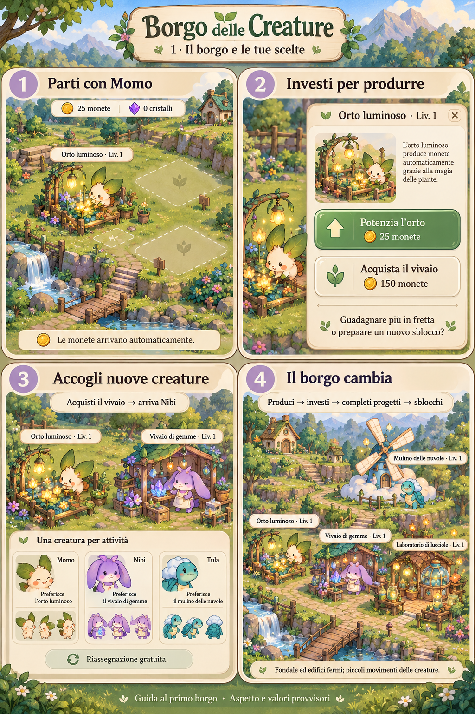
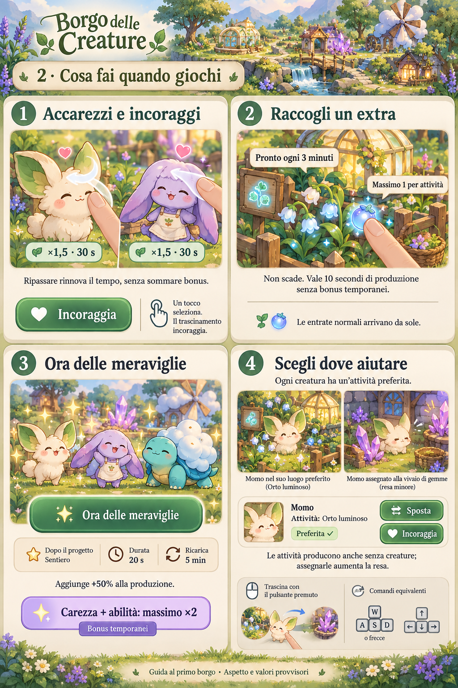
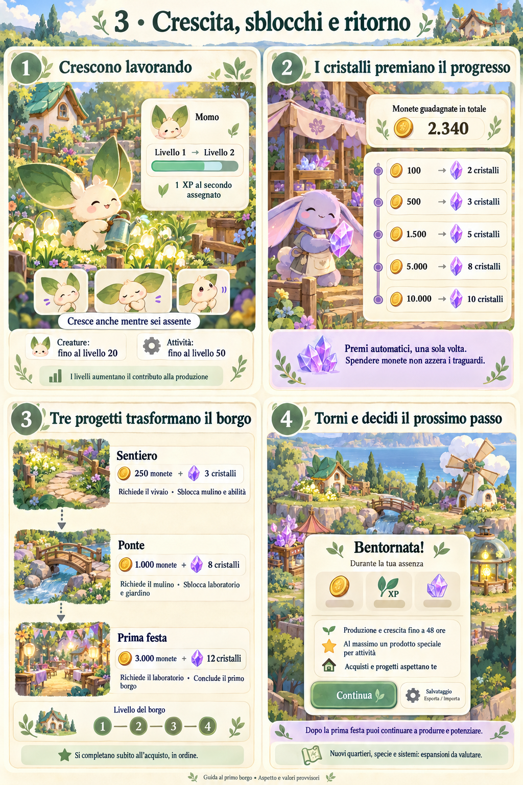

# Guida visiva al primo borgo

Tre tavole concettuali che illustrano la baseline di FIRST_PLAYABLE: non sono screenshot del gioco implementato. Aspetto dei personaggi e valori sono provvisori; le specifiche correnti e i dati di bilanciamento prevalgono sulle immagini, anche dopo future revisioni.

## 1. Il borgo e le tue scelte

Momo e l’orto iniziale, investimenti, nuove attività e arrivo delle creature. La scelta ricorrente è potenziare la produzione oppure risparmiare per il prossimo sblocco.

## 2. Cosa fai quando giochi

Incoraggiamento, prodotti speciali, Ora delle meraviglie e assegnazione delle creature. Le attività producono anche senza una creatura assegnata.

I simboli WASD e frecce nella tavola sono illustrativi: non definiscono i tasti effettivi e non indicano movimento diretto delle creature. Sono previsti comandi accessibili equivalenti al gesto. Carezza e abilità insieme portano il solo fattore dei bonus temporanei al massimo ×2; il contributo della creatura resta separato.

## 3. Crescita, sblocchi e ritorno

Livelli, traguardi che assegnano cristalli, tre progetti e ritorno dopo un’assenza. Produzione e crescita proseguono fino al limite di 48 ore; acquisti e progetti restano scelte del giocatore.

## Come usare queste immagini

Le tavole spiegano l’esperienza prevista, non sostituiscono i documenti di design e non sono asset da ritagliare per l’interfaccia. Fondale, acqua ed edifici restano statici; solo le creature hanno microanimazioni. L’interfaccia finale deve usare testi e controlli reali e adattabili. Le espansioni oltre il primo borgo restano da valutare.

Fonti delle regole: [Game design](GAME_DESIGN.md), [Sistemi](SYSTEMS.md), [Bilanciamento](../design/balance.v1.json), [Direzione artistica](ART_DIRECTION.md).
